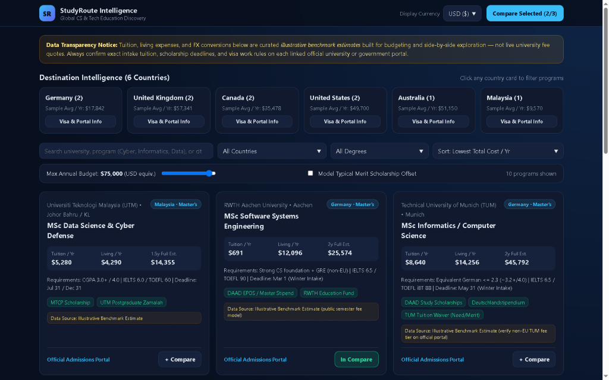

# StudyRoute Intelligence — Global Education Discovery & Comparison

> An interactive university and destination comparison platform covering tuition fees, estimated living costs, scholarships, admission requirements, multi-currency budgeting, and transparent data-provenance labeling.

---

## Application Preview




## Features

- **6-Country Destination Matrix:** Overview cards and official portal links for Germany, United Kingdom, Canada, United States, Australia, and Malaysia.
- **Multi-Currency Budget Filtering:** Filter 10 CS, Cybersecurity, and Data programs by country, degree level, annual budget slider, search query, and optional merit-scholarship modeling across USD, EUR, GBP, CAD, AUD, and PKR.
- **Side-by-Side Comparison Matrix & SVG Cost Chart:** Select up to 3 programs to compare net annual tuition, living cost, full-degree estimates, IELTS/GPA criteria, and export a structured JSON brief.
- **Strict Data Transparency:** Every record explicitly labels figures as *Illustrative Benchmark Estimates* and links directly to the institution's official admissions portal for live intake verification.

---

## Setup & Testing Locally

Serve via any static web server (required for ES modules):

```bash
npx serve .
```

Run unit tests:

```bash
node --test tests/studyroute.test.mjs
```

---

## Limitations & Responsible Data Scope

- Exchange rates (`FX_TO_USD`) and annual living/tuition benchmarks are static illustrative estimates for exploratory comparison only — always confirm official international fees, scholarship availability, and visa work rules on linked national portals (`DAAD`, `Study UK`, `EducationUSA`, `EduCanada`, `StudyAustralia`).

---

## Author

**Muzammil Shabbir**  
GitHub: [@Muzammil-s](https://github.com/Muzammil-s) · Email: muzammilw10@gmail.com
